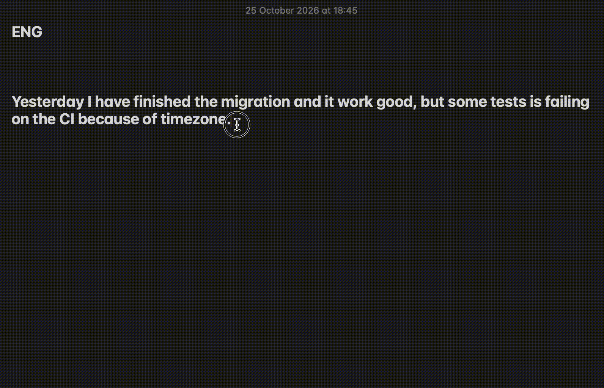

# Local LLM Writing Tools

[](https://github.com/andrew-chernous/local-llm-writing-tools/actions/workflows/ci.yml)

**A private, offline writing assistant for macOS.** Copy any text, press a hotkey, and a local LLM rephrases, proofreads or translates it. The result goes straight back to your clipboard, and **your text never leaves your machine.**

Built with [Raycast](https://raycast.com) script commands and [Ollama](https://ollama.com) running Google's Gemma 4. Stdlib-only Python, no API keys, no cloud.




## Why local?

- **Privacy.** Work Slack messages, client emails and internal docs stay on your laptop. Nothing goes to a third-party API, so there's no data-processing agreement to worry about.
- **Works offline.** On a plane, on bad Wi-Fi, behind a strict corporate proxy.
- **Free.** No per-token billing and no subscription.
- **Good enough.** For short everyday text (rewording, fixing grammar, translating a message) a small local model does the job. You don't need a frontier model for this.

## Commands

### 💬 Rephrase

Rewrites text for an **Audience** (Engineering, Non-technical, Friend, Leadership) in a **Tone** (Friendly, Neutral, Formal).

> **Before:** so basically the deploy broke cuz the env vars wasnt set on prod, i fixed it now, should be fine but we need a checklist i think
>
> **After** (Leadership / Neutral): The deployment failed because environment variables were not set in production. This has been resolved. To prevent recurrence, we need to implement a checklist.

### ✍️ Proofread

Fixes mistakes **without** making the text sound more advanced. It keeps the text at a chosen CEFR **Level** (B1, B2, B1-B2), so it still sounds like you. **Fix + explain** also shows what changed and why. Only the corrected text goes to the clipboard.

> **Before:** Yesterday I have finished the migration and it work good, but some tests is failing on the CI because of timezone.
>
> **After:** Yesterday I finished the migration and it worked well, but some tests are failing on the CI because of the timezone.
>
> 📝 *I have finished → I finished → simple past for a completed action · it work good → it worked well → past tense, and "well" is the adverb · tests is → tests are → plural subject · because of timezone → because of the timezone → specific timezone issue*

### 🌐 Translate

Translates between English, Ukrainian and Russian (or auto-detects the source) in a chosen **Tone**. Code, URLs, names and numbers stay as they are.

> **Before:** Привіт! Я завтра трохи запізнюся на мітинг, почніть без мене, будь ласка.
>
> **After** (Auto → English, Friendly): Hey! I'm gonna be a little late for the meeting tomorrow, could you please start without me?

All three Commands keep markdown formatting intact: inline code, code blocks, bold, links and lists. That matters when you paste into Slack, GitHub or Jira.

## Setup

Requires macOS, Python 3.9+ (the `python3` that ships with Xcode Command Line Tools is fine) and Raycast.

```sh
brew install ollama
ollama serve &                    # or open the Ollama app
ollama pull gemma4:e4b-it-qat     # ~6 GB, the default model

git clone https://github.com/andrew-chernous/local-llm-writing-tools.git
```

In Raycast: **Settings → Extensions → + → Add Script Directory**, then pick the `commands/` folder. Assign hotkeys to Rephrase, Proofread and Translate.

If something is wrong, the Command tells you how to fix it, for example:

```
⚠️  Model 'gemma4:e2b' is not installed.
Run: ollama pull gemma4:e2b
```

## Customize

- **Add a model:** `ollama pull <model>`, then add it to the `Model` dropdown in the `@raycast.argument3` header of `rephrase.py` / `proofread.py`. Translate uses `DEFAULT_MODEL` in `commands/ollama_client.py`, because Raycast allows at most three arguments and Translate already uses all three.
- **Add a language:** add it to `LANG_NAMES` in `translate.py` and to both language dropdowns in its header.
- **Add an audience or tone:** add an entry to `AUDIENCE_HINTS` (`rephrase.py`) or `TONE_HINTS` (`ollama_client.py`), plus the matching dropdown item.

## How it works

```
Hotkey → Raycast runs commands/<command>.py with the dropdown values
       → pbpaste → system prompt built from the options
       → POST localhost:11434/api/chat (Ollama) → pbcopy → result shown in Raycast
```

Engineering notes:

- **Zero dependencies.** Raycast runs scripts with the system `python3`, so everything uses the standard library (`urllib`, `subprocess`). The shared code lives in `commands/ollama_client.py`.
- **Prompts written for small models.** Explicit "return ONLY the text, no preamble" rules, a fixed `===NOTES===` marker that is easy to split on (Proofread always splits, because small models sometimes emit the marker even when they weren't asked to), and Gemma's thinking mode turned off so the token budget goes to the answer.
- **Sampling per task.** Proofread runs at temperature 0.3 because it should be predictable. Rephrase and Translate run at 1.0, so pressing the hotkey again gives you a different wording.
- **Clipboard encoding.** Raycast launches scripts without a locale, so the clipboard is read as bytes and decoded as UTF-8, then CP1251, then CP1252. Cyrillic text pasted from older Windows apps still works.
- **The clipboard is never overwritten with junk.** An empty model reply, a missing model or Ollama being down exits before anything is copied.
- **Tests and CI.** `pytest` covers prompt building, Notes splitting, input guards and Ollama error mapping (with HTTP mocked); `ruff` handles lint and formatting. Both run on GitHub Actions.

The domain vocabulary (Command, Tone, Audience, Level, ...) is defined in [CONTEXT.md](CONTEXT.md).

## Development

```sh
python3 -m venv .venv && .venv/bin/pip install pytest ruff
.venv/bin/ruff check . && .venv/bin/ruff format --check . && .venv/bin/pytest
```

## License

[MIT](LICENSE)
